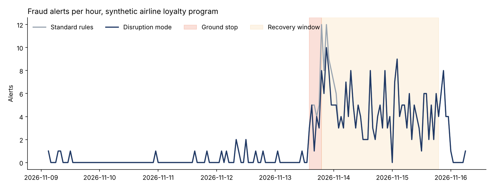

# Airline Disruption Fraud Monitor

When flights get grounded, fraudsters go to work. Stranded travelers are stressed, searching for help, and clicking on anything that says "rebook your flight." That creates a burst of fake support numbers, phishing texts, loyalty account takeovers, and waiver and refund abuse. At the same time, thousands of honest customers start doing things that look a lot like fraud: logging in from a different city, resetting a forgotten password at the gate, and burning miles on a last-minute hotel.

I built this project after the November 2026 nationwide FAA ground stop to work through a question I find interesting: **how should a fraud operations team detect, triage, and staff for a disruption spike without burying analysts in good customers?**

Everything here runs on **synthetic data**. There is no real airline, customer, or system data, and it isn't modeled on any specific company's controls.



## What it does

1. **Generates a week of loyalty program activity** (`generate_data.py`) for 5,000 made-up members, with a five-hour ground stop on Friday afternoon and a 48-hour recovery window after it.
2. **Plants four fraud patterns** alongside realistic honest-customer noise:
   | Scenario | What it looks like |
   |---|---|
   | Phishing account takeover | New device and location, password reset, contact change, then miles drained within minutes |
   | Low-and-slow takeover | Same state as the member, a fresh device, and a wait of hours before a partial cash-out |
   | Fake support social engineering | Contact-center password reset, then a miles transfer to a mule account |
   | Waiver and refund abuse | A free waiver rebook *and* a refund on the same booking |
3. **Scores every money-out event** (redemptions, miles transfers, refund requests) against eight explainable rules (`detect.py`), then builds a P1/P2 triage queue.
4. **Runs two configurations side by side.** *Standard* uses the same rules all week. *Disruption mode* stops penalizing hub-city logins on a member's own device during the ground stop and recovery window, since that is what stranded travelers look like.
5. **Reports the numbers a fraud ops leader actually watches**: alert volume, precision, recall, false positives, prevented and missed loss, analyst hours, and analysts needed per day.

## Results from the sample run

| | Standard rules | Disruption mode |
|---|---|---|
| Alerts | 303 | 282 |
| False positives | 52 | **31** |
| Precision | 0.83 | **0.89** |
| Recall | 0.90 | 0.90 |

Disruption mode cut false positives by about 40% without losing a single true positive.

**Staffing.** Daily alert volume went from a handful to 100+ on the two days after the ground stop. At 20 minutes per alert, that is the jump from less than one analyst to five or more. The `Daily staffing view` in [`reports/summary.md`](reports/summary.md) is the kind of number I'd want in front of leadership *before* the next disruption, not during it.

**Known gap.** The rules catch only about 40% of the low-and-slow takeovers. Attackers who stay in the member's home state and wait a few hours before cashing out slip under rules tuned for speed. In a real program, that is where I'd push next: session and behavioral signals, device intelligence, and a review of accounts with a recent reset and a new device, even when nothing has moved yet.

## The rules

| Rule | Points | Signal |
|---|---|---|
| R1 | 40 | Password reset or contact change in the prior 60 minutes |
| R2 | 15 | Device first seen on the account in the last 24 hours |
| R3 | 10 | Activity outside the member's home state (relaxed in disruption mode) |
| R4 | 25 | Contact-center password reset in the prior 2 hours |
| R5 | 35 | Receiving account got transfers from 3+ members in 24 hours |
| R6 | 20 | Takes 70%+ of the member's miles balance |
| R7 | 50 | Booking already rebooked on a waiver or refunded |
| R8 | 25 | Device already used by 3+ different members |

A score of 50 or more creates an alert, and 80 or more is P1. Every alert lists the rules it hit, so an analyst can see *why* it fired. Explainability matters when you are deciding whether to freeze a real customer's account.

## Run it

```bash
pip install -r requirements.txt
python generate_data.py   # writes data/events.csv and data/members.csv
python detect.py          # writes reports/summary.md, triage_queue.csv, alerts_per_hour.png
```

## Why I care about this

I started my career working account takeover and unauthorized-transaction claims at Chase, and spent the last several years running high-risk review and investigations teams in crypto, including forecasting caseloads and staffing when volume spiked. A disruption event is the same problem in a different industry: fraud follows the chaos, and the team that has planned for the surge is the one that protects customers without making a bad day worse.

## Related projects

- [FinCEN Advisory & Guidance Tracker](https://github.com/angelalara1219)
- [CTR/GTO Monitor](https://github.com/angelalara1219)
- [Sanctions List Tracker](https://github.com/angelalara1219)

---
Angela Lara, CAMS · [LinkedIn](https://www.linkedin.com/in/angela-lara-cams-197b6251/)
