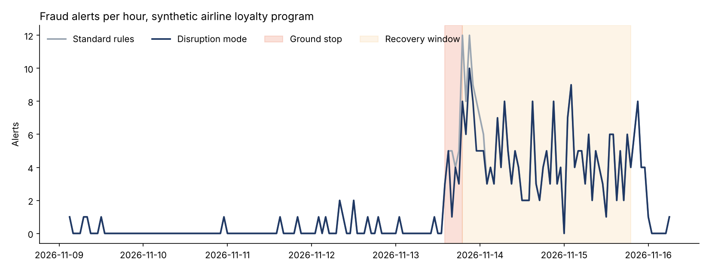

# Run summary

Synthetic data only. Numbers show how the approach behaves, not real airline results.

## Disruption mode vs. standard rules
Disruption mode removed **21** false positives over the week (honest travelers stranded in hub cities on their own phones).

### Standard rules
| period | money_out_events | alerts | p1_alerts | true_positives | false_positives | precision | recall | prevented_loss_usd | missed_loss_usd | analyst_hours |
|---|---|---|---|---|---|---|---|---|---|---|
| baseline | 225 | 18 | 18 | 18 | 0 | 1.0 | 0.75 | 9,295 | 3,048 | 6.0 |
| ground_stop | 85 | 22 | 6 | 5 | 17 | 0.23 | 0.71 | 1,620 | 385 | 7.3 |
| recovery | 730 | 235 | 115 | 200 | 35 | 0.85 | 0.93 | 124,331 | 7,210 | 78.3 |
| post_recovery | 39 | 28 | 15 | 28 | 0 | 1.0 | 0.85 | 11,171 | 1,587 | 9.3 |
| ALL | 1,079 | 303 | 154 | 251 | 52 | 0.83 | 0.9 | 146,417 | 12,230 | 101.0 |

### Disruption mode
| period | money_out_events | alerts | p1_alerts | true_positives | false_positives | precision | recall | prevented_loss_usd | missed_loss_usd | analyst_hours |
|---|---|---|---|---|---|---|---|---|---|---|
| baseline | 225 | 18 | 18 | 18 | 0 | 1.0 | 0.75 | 9,295 | 3,048 | 6.0 |
| ground_stop | 85 | 16 | 6 | 5 | 11 | 0.31 | 0.71 | 1,620 | 385 | 5.3 |
| recovery | 730 | 220 | 115 | 200 | 20 | 0.91 | 0.93 | 124,331 | 7,210 | 73.3 |
| post_recovery | 39 | 28 | 15 | 28 | 0 | 1.0 | 0.85 | 11,171 | 1,587 | 9.3 |
| ALL | 1,079 | 282 | 154 | 251 | 31 | 0.89 | 0.9 | 146,417 | 12,230 | 94.0 |

## Recall by fraud scenario (disruption mode)
| scenario | fraud_events | caught | recall |
|---|---|---|---|
| ato_phishing | 108 | 108 | 1.0 |
| ato_phishing_low_and_slow | 47 | 19 | 0.4 |
| fake_support_social_engineering | 45 | 45 | 1.0 |
| waiver_refund_abuse | 79 | 79 | 1.0 |

## Rule performance (disruption mode, alerted events)
| rule | description | points | alerts | fraud | precision_when_present |
|---|---|---|---|---|---|
| R1_recent_credential_change | Password reset or contact change in the prior 60 min | 40 | 183 | 152 | 0.83 |
| R2_new_device | Device first seen on this account in the last 24 hours | 15 | 188 | 172 | 0.91 |
| R3_new_geo | Activity from outside the member's home state | 10 | 114 | 108 | 0.95 |
| R4_call_center_reset | Contact-center password reset in the prior 2 hours | 25 | 45 | 45 | 1.0 |
| R5_mule_account | Receiving account got transfers from 3+ members in 24h | 35 | 89 | 89 | 1.0 |
| R6_balance_drain | Takes 70%+ of the member's miles balance | 20 | 156 | 136 | 0.87 |
| R7_duplicate_claim | Booking already rebooked on a waiver or refunded | 50 | 79 | 79 | 1.0 |
| R8_shared_device | Device already used by 3+ different members | 25 | 47 | 47 | 1.0 |

## Daily staffing view
Assumes 20 minutes per alert and 6.5 productive hours per analyst per day.

| date | alerts | analyst_hours | analysts_needed |
|---|---|---|---|
| 2026-11-09 | 4 | 1.3 | 0.2 |
| 2026-11-10 | 1 | 0.3 | 0.0 |
| 2026-11-11 | 2 | 0.7 | 0.1 |
| 2026-11-12 | 9 | 3.0 | 0.5 |
| 2026-11-13 | 55 | 18.3 | 2.8 |
| 2026-11-14 | 102 | 34.0 | 5.2 |
| 2026-11-15 | 107 | 35.7 | 5.5 |
| 2026-11-16 | 2 | 0.7 | 0.1 |

